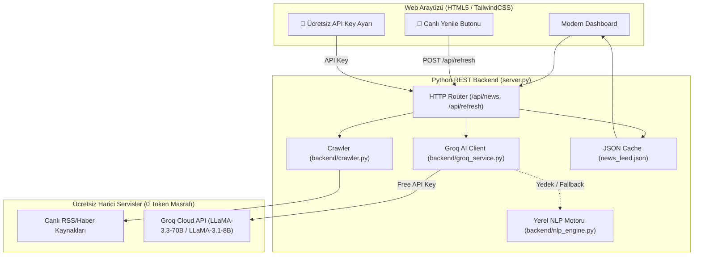

# Task Plan: Free Groq AI & Live News REST API Integration

## 1. Overview & Objective
Integrate a 100% free, zero-token-cost AI summarization and live news pipeline into the AI News Platform.
- **Cost**: 0$ (Free Groq Cloud API tier + Free RSS/REST News).
- **Quota Safety**: Completely independent of the user's Antigravity/Gemini token limits.
- **Resilience**: Automatic fallback to local NLP engine (TF-IDF/Cosine/Sentence Ranking) if no API key is provided or if network is offline.

## 2. Architecture & Components

## 3. Implementation Steps

1. **Groq AI Service Module (`backend/groq_service.py`)**:
   - Implement direct HTTP calls to `https://api.groq.com/openai/v1/chat/completions` using `requests` (no extra SDK required).
   - Prompt engineering in Turkish: Professional, neutral 2-sentence journalistic summary + key takeaway bullet point.
   - Robust error handling: Rate limit detection, timeout protection (8s), and graceful fallback to `nlp_engine.extractive_summarize`.

2. **REST API Server (`server.py`)**:
   - Upgrade from basic static server to full REST API server using Python's standard library `http.server`.
   - Endpoints:
     - `GET /api/news`: Returns cached news and system stats.
     - `POST /api/refresh`: Triggers crawler + Groq/NLP pipeline, saves to `news_feed.json`, and returns fresh payload.
     - `GET /api/status`: Returns current AI engine status (Groq Active vs. Local NLP Fallback).
     - Static file serving for `frontend/` files.

3. **Frontend Enhancements (`frontend/index.html`)**:
   - Add a sleek "🔄 Canlı Yenile" (Live Refresh) button with loading spinner.
   - Add an "AI Durumu & Anahtar" (Engine Status: Groq LLaMA 3.3 vs. Yerel NLP) badge.
   - Add an API Key modal so the user can easily paste their free Groq API key or toggle local mode, saved safely in `localStorage` or session.
   - Modernize the summary cards to show which model generated the summary (e.g. `⚡ Groq LLaMA 3.3` or `🧠 Yerel NLP (Sıfır Token)`).

4. **Verification & Testing (`verify-changes`)**:
   - Test REST endpoints with python test script.
   - Test fallback behavior when API key is absent.
   - Verify zero errors and syntax validity.
